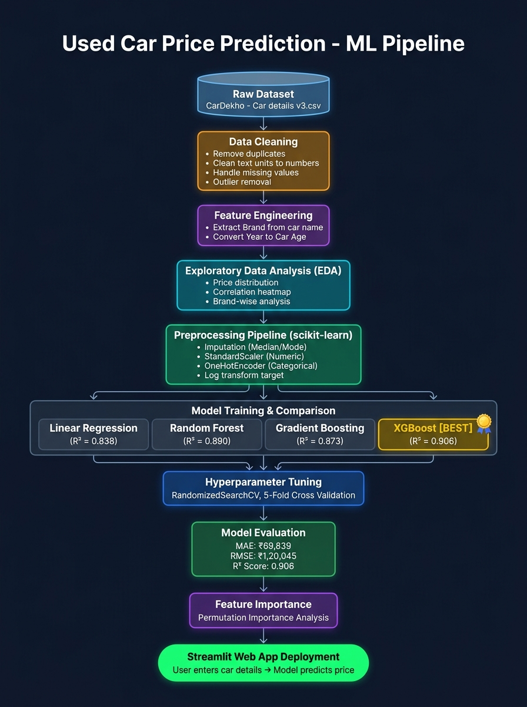
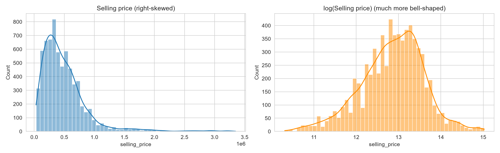
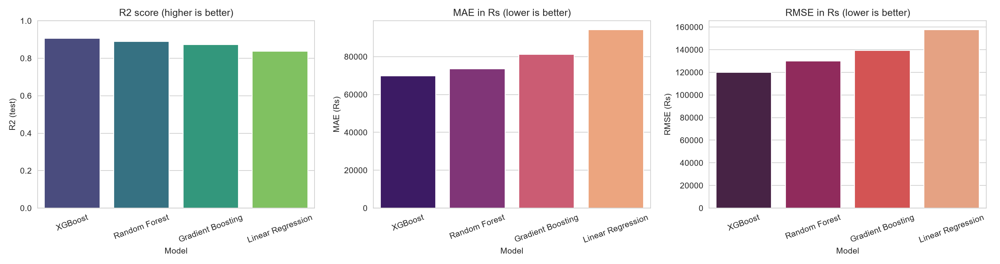
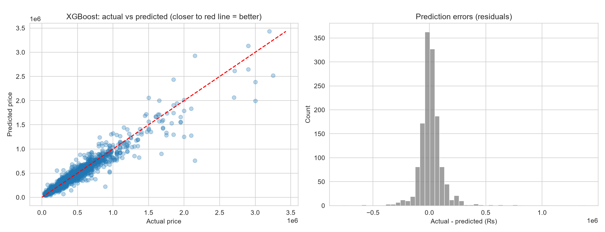
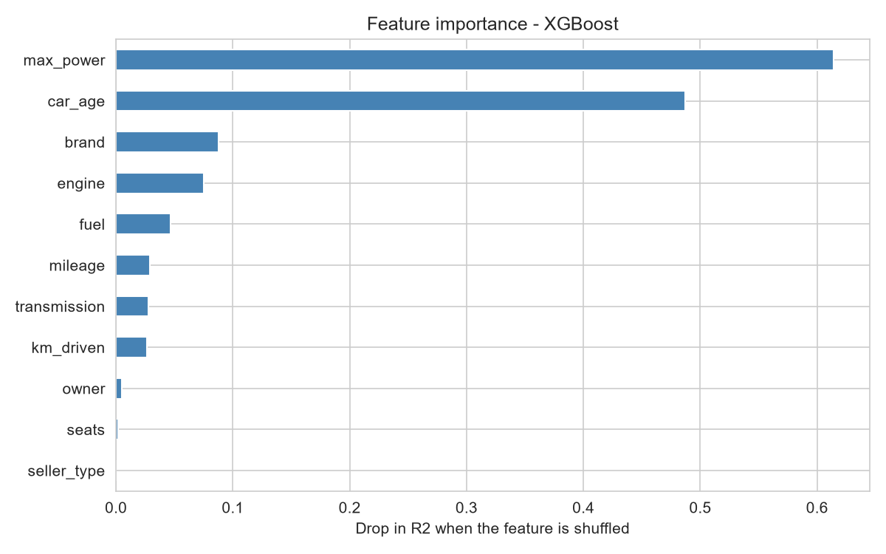
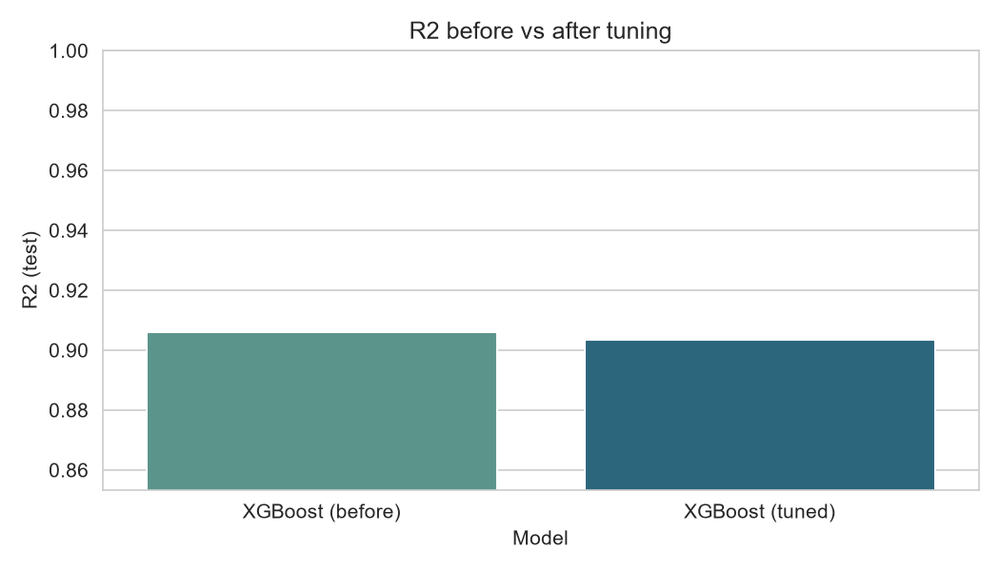

<h1 align="center">🚗 Used Car Price Predictor (India)</h1>

<p align="center">
  
  
  
  
  
</p>

<p align="center">
  An end-to-end machine learning project that predicts the resale price of a used car in India — from raw CSV data to a live Streamlit web app.
</p>

---

## 📌 Table of Contents
- [Problem Statement](#-problem-statement)
- [Dataset](#-dataset)
- [ML Pipeline Flowchart](#-ml-pipeline-flowchart)
- [Project Workflow](#-project-workflow)
- [Model Results](#-model-results)
- [Tech Stack](#-tech-stack)
- [Project Structure](#-project-structure)
- [Run It Yourself](#-run-it-yourself)
- [Screenshots](#-screenshots)
- [Future Scope](#-future-scope)

---

## 🎯 Problem Statement

Buyers and sellers of used cars often struggle to determine a **fair market price**. This project builds a regression model trained on real CarDekho listings to **estimate a car's resale price (in ₹ INR)** given its:

- Brand, Fuel type, Transmission, Owner type
- Car Age, Kilometres Driven
- Engine (CC), Max Power (bhp), Mileage (kmpl), Seats

---

## 📊 Dataset

| Property | Details |
|---|---|
| **Source** | [CarDekho Vehicle Dataset – Kaggle](https://www.kaggle.com/datasets/nehalbirla/vehicle-dataset-from-cardekho) |
| **File** | `Car details v3.csv` |
| **Target** | `selling_price` (INR) |
| **Features** | Brand, Car Age, KM Driven, Fuel, Seller Type, Transmission, Owner, Mileage, Engine, Max Power, Seats |
| **Brands Covered** | 31 brands (Maruti, Hyundai, Honda, Toyota, BMW, Audi, Mercedes-Benz, and more) |

---

## 🔄 ML Pipeline Flowchart



> The diagram above shows the complete end-to-end pipeline — from raw data ingestion to model deployment.

---

## 📋 Project Workflow

### Step 1 — Data Cleaning
- Removed duplicate records
- Converted text columns with units to numeric values  
  (e.g. `"19.7 kmpl"` → `19.7`, `"1248 CC"` → `1248`)
- Handled missing values
- Removed outliers using IQR / domain-based thresholds

### Step 2 — Feature Engineering
| Raw Feature | Engineered Feature |
|---|---|
| `name` (full car name) | `brand` (first word extracted) |
| `year` (manufacturing year) | `car_age` = 2024 − year |

### Step 3 — Exploratory Data Analysis (EDA)
- Price distribution (right-skewed → log transform used)
- Price vs Age, KM Driven, Engine, Max Power
- Price by Fuel type, Transmission, Brand
- Correlation heatmap

> All charts are saved in the `images/` folder.

### Step 4 — Preprocessing Pipeline (scikit-learn)
Built inside a `sklearn.Pipeline` to **prevent data leakage**:

```
Numeric columns  →  Median Imputation  →  StandardScaler
Categorical cols →  Mode Imputation    →  OneHotEncoder
Target           →  log(selling_price) [inverse-transformed for predictions]
```

### Step 5 — Model Training & Comparison
Trained 4 regression models on the same train/test split with 5-fold cross-validation:

| Model | MAE (₹) | RMSE (₹) | R² (Test) | R² (5-CV) |
|---|---|---|---|---|
| XGBoost ⭐ | 69,839 | 1,20,045 | **0.906** | **0.904** |
| Random Forest | 73,613 | 1,30,028 | 0.890 | 0.890 |
| Gradient Boosting | 81,192 | 1,39,224 | 0.873 | 0.895 |
| Linear Regression | 94,220 | 1,57,654 | 0.838 | 0.843 |

**Winner: XGBoost** with R² = 0.906 and MAE ≈ ₹69,839

### Step 6 — Hyperparameter Tuning
- Used `RandomizedSearchCV` on XGBoost
- 5-fold cross-validation across parameter grid
- Tuned: `n_estimators`, `max_depth`, `learning_rate`, `subsample`, `colsample_bytree`
- Before vs after comparison saved in `tuning_before_after.csv`

### Step 7 — Explainability
- Permutation feature importance computed on test set
- **Top features:** `max_power`, `car_age`, `engine`, `km_driven`, `brand`

### Step 8 — Deployment
- Final pipeline saved as `car_price_model.joblib`
- Model metadata saved to `model_meta.json`
- Streamlit web app (`app.py`) loads the model and serves predictions

---

## 🏆 Model Results

```
Best Model  : XGBoost (tuned)
R² Score    : 0.906   (explains 90.6% of price variance)
MAE         : ₹69,839 (average prediction error)
RMSE        : ₹1,20,045
```

---

## 🛠 Tech Stack

| Category | Tools |
|---|---|
| **Language** | Python 3.9+ |
| **Data Processing** | pandas, NumPy |
| **Visualization** | Matplotlib, Seaborn |
| **Machine Learning** | scikit-learn, XGBoost |
| **Model Saving** | joblib |
| **Web App** | Streamlit |
| **Notebook** | Jupyter |

---

## 📁 Project Structure

```
used-car-price-predictor/
│
├── used_car_price_prediction.ipynb   # Full EDA, training, and evaluation notebook
├── app.py                            # Streamlit web app
│
├── Car details v3.csv                # Raw dataset
├── car_price_model.joblib            # Trained XGBoost pipeline
├── model_meta.json                   # App metadata (brands, medians, scores)
├── model_comparison_results.csv      # All model metrics
├── tuning_before_after.csv           # Hyperparameter tuning results
│
├── images/
│   ├── flowchart.png                 # ML pipeline flowchart
│   ├── 01_price_distribution.png
│   ├── 02_numeric_vs_price.png
│   ├── 03_categorical_vs_price.png
│   ├── 04_brand_median_price.png
│   ├── 05_correlation_heatmap.png
│   ├── 06_model_comparison.png
│   ├── 07_actual_vs_predicted.png
│   ├── 08_tuning_before_after.png
│   └── 09_feature_importance.png
│
├── requirements.txt
└── README.md
```

---

## 🚀 Run It Yourself

### 1. Clone the Repository
```bash
git clone https://github.com/mahiwegad/Minor_Project_Used_car_price_prediction.git
cd Minor_Project_Used_car_price_prediction
```

### 2. Install Dependencies
```bash
pip install -r requirements.txt
```

### 3. Run the Notebook
Open `used_car_price_prediction.ipynb` in Jupyter and run all cells.  
This will train the model and save `car_price_model.joblib` and `model_meta.json`.

### 4. Launch the Web App
```bash
streamlit run app.py
```
Then open **http://localhost:8501** in your browser.

---

## 📸 Screenshots

### EDA — Price Distribution


### Model Comparison


### Actual vs Predicted


### Feature Importance


### Hyperparameter Tuning


---

## 🔮 Future Scope

- 🌆 Add **city/location** as a feature
- 🔧 Add **car condition rating** input
- 📊 Show **prediction confidence intervals**
- 🤖 Try **stacking ensembles** (XGBoost + Random Forest)
- 🔄 **Retrain periodically** on fresher listings
- 📱 Deploy as a **mobile-friendly PWA**

---

## 👩‍💻 Author

**Mahi Wegad**  
Minor Project — Semester 5  
GitHub: [@mahiwegad](https://github.com/mahiwegad)

---

<p align="center">⭐ Star this repo if you found it useful!</p>
